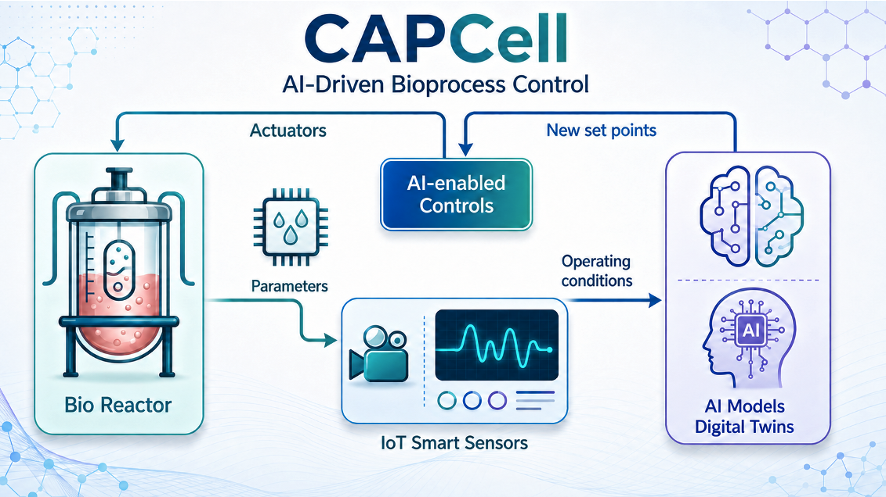
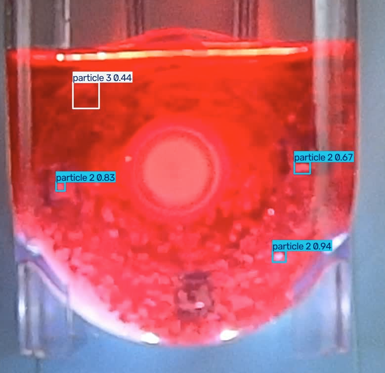
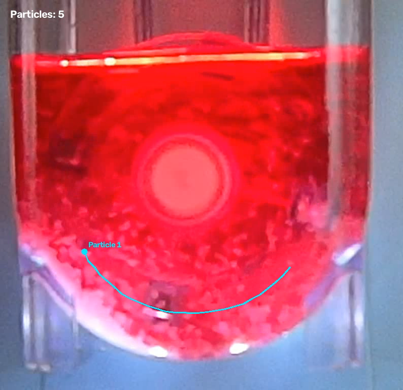
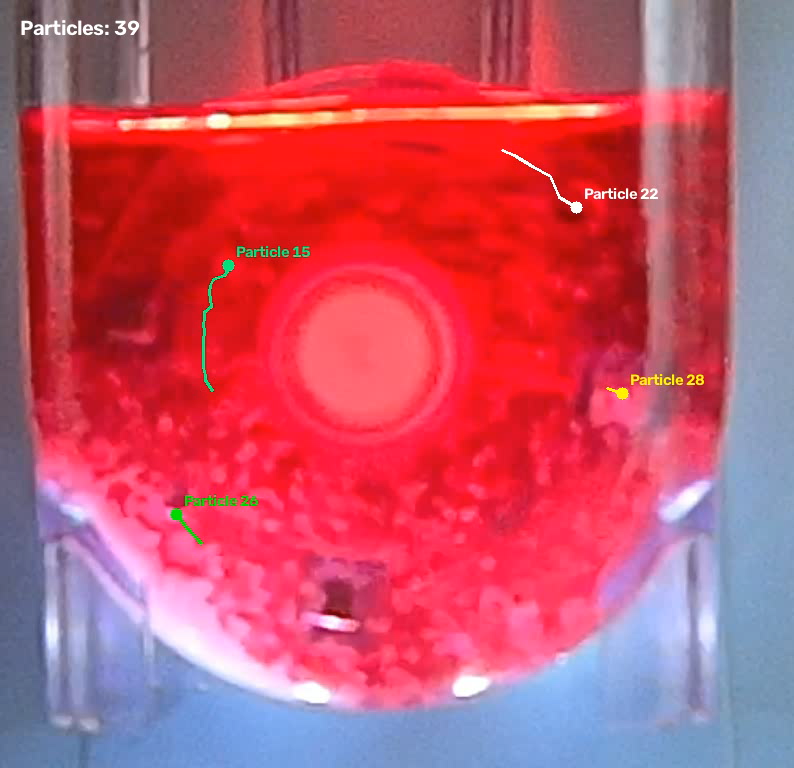

# AI for Detecting and Tracking Particles in Bioreactors

**An AI-driven computer vision project for particle detection, tracking, and analysis in bioreactor environments.**

## Overview

This project explores the application of artificial intelligence (AI) and computer vision techniques to detect and track particles in bioreactor environments. The goal is to develop computational tools that support the analysis of particle motion and behavior, contributing to improved monitoring and understanding of bioprocesses.

The project is currently under development as part of ongoing research activities associated with the Center for AI-Driven Bioprocess Control for Cell Manufacturing (CAPCell) initiative.

## Research Objectives

The main objectives of this project are to:

- Develop computer vision methods for automated particle detection in images and video.
- Investigate particle tracking approaches to analyze particle trajectories across video frames.
- Evaluate AI-based methods for their ability to identify and follow particles over time.
- Explore the potential of these methods to support quantitative analysis and monitoring of bioreactor processes.

## Current Progress

The project is actively under development. Current work focuses on developing and evaluating an AI-based pipeline for particle detection and tracking.

<table>
  <tr>
    <td align="center" width="33%">
      
       
      <strong>(a) Particle detection</strong>
    </td>
    <td align="center" width="33%">
      
       
      <strong>(b) Single-particle tracking</strong>
    </td>
    <td align="center" width="33%">
      
       
      <strong>(c) Multi-particle tracking</strong>
    </td>
  </tr>
</table>

  <em>Figure 2. Examples of particle detection and tracking in bioreactor videos. The pipeline performs YOLO-based particle detection and tracks individual or multiple particles across consecutive video frames.</em>

Progress to date includes:

- **Object detection:** Development and testing of a YOLO-based particle detection pipeline.
- **Particle tracking:** Implementation and evaluation of tracking strategies to maintain particle identities across consecutive video frames.
- **Experimental evaluation:** Testing the pipeline on video data to assess detection performance and tracking continuity.
- **Visualization:** Generation of visual results to inspect detected particles and their trajectories.

Additional development and evaluation are ongoing. The methods, results, and capabilities presented here may evolve as the research progresses.

## Video Demonstrations

The following videos showcase the AI-based particle detection and tracking pipeline developed for bioreactor environments.

### Video 1. YOLO Particle Detection

### Video 2. YOLO Particle Tracking
https://youtu.be/FK5SrCv3sPs

### Video 3. DINO Particle Detection and Tracking
https://youtu.be/JquBo0jxlCk

> **Note:** This is a research showcase, not a software release. Source code, implementation details, and research datasets are not included in this public repository.

## Project Status

**Status: In progress**

The project is currently in the research, development, and experimental evaluation phase. Further work will focus on improving detection and tracking performance, evaluating the approach under different conditions, and exploring its applicability to bioreactor monitoring.

## Collaboration and Inquiries

Researchers, students, and potential collaborators interested in this project are welcome to get in touch.

For inquiries about the research, potential collaborations, or opportunities to participate in future developments, please contact michael.alvarez2@upr.edu

## Research Team

- **Michael A. Álvarez-Navarro** — Principal Investigator, Assistant Professor, Department of Computer Science, University of Puerto Rico–Río Piedras.
- **Mateo Florez** — Graduate Student.
- **Emmaluz Montaner** — Undergraduate Student.
- **Emma Moreira** — Undergraduate Student.

Please reach out through GitHub or the contact information available on my academic profile.

## Acknowledgments

This research is conducted within the **Center for AI-Driven Bioprocess Control for Cell Manufacturing (CAPCell)** initiative, supported by the U.S. National Science Foundation through NSF Award [2546506](https://www.nsf.gov/awardsearch/show-award?AWD_ID=2546506).

Additional acknowledgments and project information will be added as the research progresses.

---

*This repository is intended to communicate research objectives, document selected progress, and facilitate scientific exchange. It does not provide access to the project's source code or constitute a software release.*
